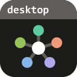

# hub-desktop

One place to start every `*-desktop` and `*-web` app: a local hub that shows each app as a tile and
opens it as a native app or as a web app with a single click.

> **Status: first milestone.** The hub lists the installed apps as tiles and starts them with one click, natively or
> as a web app. There is no versioned release yet; the newest state of `main` is on the
> [`latest` pre-release](https://github.com/WKDSteve/hub-desktop/releases/tag/latest).

## Install (Windows)

In your own PowerShell (not elevated; no administrator rights, no SmartScreen stop):

```
powershell -ExecutionPolicy Bypass -c "& ([scriptblock]::Create((irm https://github.com/WKDSteve/hub-desktop/releases/download/latest/install.ps1))) -InstallArgs '--shortcut'"
```

This puts a link **Hub** on the desktop and in the Start menu (one click starts the hub and opens its page). Without
`-InstallArgs '--shortcut'` there is no link: start `%LOCALAPPDATA%\hub-desktop\bin\hub-desktop.exe`, or run
`hub-desktop install --shortcut` later. `hub-desktop uninstall` and `uninstall.ps1` take the links away again. The hub
needs none of the other apps to run.

## What it does

- **Installed apps** appear as tiles: `tasks-desktop`, `rules-desktop`, `testing-desktop`, `docmap-desktop`,
  `ai-desktop` and the apps that follow. One click starts the app (its own hub first, if it is not running) and
  opens it, natively or as its web variant. Nothing else needs to be clicked.
- **Apps that are not installed** appear darkened in a separate area, *Install or download*, with a
  link to the release page and its checksums. An app without a release (`pult`, a real tile once built: start, stop, its remote control page) says to build it from
  its checkout, an app that does not exist yet (`Takt Player`) says it is planned.
- **Updates** with one click per tile, or all at once with **Update all**: the program from its release, the web
  variant from its clone (see below).
- Later: handing work from one app to another, and report viewers.

## How it is built

`hub-desktop` follows its sibling apps:

- a small web server on your own machine (`127.0.0.1` only), built on
  [appkit](https://github.com/WKDSteve/appkit), with its guard and pairing;
- the page in Svelte 5 on appkit's `ui-kit`;
- a catalog of the known apps compiled into the program: it only names fixed ways to detect and
  start an app, never a command line;
- a web variant `hub-web` (one HTML file, no server) for machines where no native program may run;
- a mark with one spoke per installed app (up to ten) in the bar and the tab of the page; the program and
  its links keep the one with five.

## Build and run from source

```
cd ui && pnpm install --frozen-lockfile && pnpm build && cd ..
cargo build --release --locked
target/release/hub-desktop            # runs the hub in this window and opens the browser
```

`hub-desktop open --launch` opens a paired page for a hub that runs, `hub-desktop stop` ends it. Checks before a
change: `cargo fmt --all --check`, `cargo clippy --workspace --all-targets --locked -- -D warnings`,
`cargo test --workspace --locked` and, in `ui/`, `pnpm check && pnpm test`.

## License

[MIT](LICENSE)

## Web hub (for machines that may not run programs)

`hub.html` is the same page as one file that is opened from disk: no program, no server. It lists the web variants
(`tasks-web`, ...) as links to the page next to it, so clone the `*-web` repositories side by side in one folder. A
program is shown as "native only". The page cannot look at your machine: an app that is not there is one you mark
yourself ("Mark as not present" in the menu of the tile), or all at once: **Choose the folder of the clones** (Chrome
and Edge) opens the folder dialog, and every web variant whose page is not in the folder you pick is marked, the rest
unmarked. The page reads only the names in that folder and keeps nothing of it but the marks. Build it with `cd ui && pnpm web:build`
(`ui/dist-web/hub.html`).

## Hide, order and stop

Put a file `catalog-overlay.json` into the config folder of the hub to hide or order tiles:

```json
{ "schema": "hub-catalog/1", "hidden": ["streamtap"], "order": ["tasks", "rules"], "web_root": "C:/repos" }
```

It can only hide, order and name the folder of the web variants (`config.json` wins when it names one too). A
newer schema (`hub-catalog/2`) is refused, keys it does not know are ignored, and a program or a way to start one
cannot be put in it. A file that cannot be used is reported in the console of the hub and ignored. A hidden app is
not listed, not started and its page is not served.

An app built on the kit (Tasks, Rules) that runs has a **Stop** entry in the menu of its tile: the hub runs
`<program> stop` of that app, nothing else.

## Update the apps

**Update** in the menu of a tile (and on the tile, once **Check for updates** found a newer build) updates that app;
**Update all** updates every app that has something to update here, one after the other, and goes on with the next
when one fails. The section **Updates** shows where each one is, what came of it and the last lines of its output.

- **The web variant** (a clone of `tasks-web`, ...): `git pull --ff-only` in the clone, then the page is checked
  against the `SHA256SUMS` of the clone, as `start-tasks.cmd /update` does. A clone with local changes or on another
  branch than `main` is not touched (no stash, no reset, no rebase): the tile says why. An open page needs a reload.
- **The program** (an app with a release): `gh` downloads `install.ps1`, `SHA256SUMS` and the file of the rolling
  build `latest`, the hub checks the script and the file against `SHA256SUMS`, and only then runs the script, which
  checks the file again and installs it for you. Tasks and Rules stop, replace and restart themselves in their
  `install` (a failure leaves the old program and your autostart entry). AI Desktop must be closed first. Needs the
  [GitHub CLI](https://cli.github.com) signed in (`gh auth login`; it also reaches the private repositories) and
  Windows PowerShell.
- **On the workstation** (`NVIM_MACHINE_ROLE=workstation`) the hub installs no program, and neither does it when the
  role is unclear (another value, or an unset one on a managed machine): the clones are still pulled. The role is
  read when the hub starts.
- **The web hub** (`hub.html`) runs nothing: its section **Update the pages** lists the lines to type in the folder
  of the clones.

The page only names the app; what runs is decided by the catalog of the hub and what it found on the machine, never
by the request.

## Testing monitor

Name the export folder of [testing.nvim](https://github.com/WKDSteve/testing.nvim) in `config.json`
(`{ "testing_export": "C:/results/export" }`, an absolute folder) and the page shows a **Testing** section with a
light for each repository: red, check (partly run, outdated, CI running or unknown), green, or no result. The worst
of the local result, the local pipeline and the CI wins. A row whose last local run was red has a **Red cases**
button: it shows the red cases of that run by file and line, with the message, expected and actual as plain text (as
testing.nvim wrote them into the export, already without paths of your machine). The hub reads the folder (`testing export --out`) and starts
nothing; the history and the start of a run stay with testing.nvim. A folder that cannot be read is said in one
sentence, without its path.
