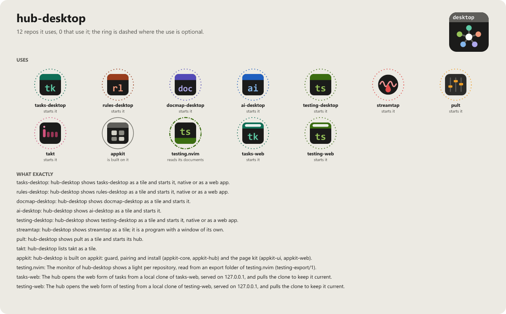

# hub-desktop

[](https://wkdsteve.github.io/wkd/apps/hub-desktop/)

One place to start every `*-desktop` and `*-web` app: a local hub that shows each app as a tile and
opens it as a native app or as a web app with a single click.

> **Status: alpha, first milestone.** The hub lists the installed apps as tiles and starts them with one click, natively or
> as a web app. There is no versioned release yet; the newest state of `main` is on the
> [`latest` pre-release](https://github.com/WKDSteve/hub-desktop/releases/tag/latest).

## Install (Windows)

In your own PowerShell (not elevated; no administrator rights, no SmartScreen stop):

```
& ([scriptblock]::Create((irm https://github.com/WKDSteve/hub-desktop/releases/download/latest/install.ps1))) -InstallArgs '--shortcut'
```

Type the line into the PowerShell session as it is. Wrapped in a new `powershell -ExecutionPolicy Bypass -c "..."`, Microsoft Defender reports the command line as a trojan (`Trojan:Win32/Commando.B!ml`) and nothing is installed.

Every file of a release and of the rolling build is attested by the workflow that built it. With the GitHub CLI
installed, the install script checks that itself; by hand:
`gh attestation verify <file> -R WKDSteve/hub-desktop --signer-workflow WKDSteve/hub-desktop/.github/workflows/rolling.yml`
(`release.yml` for a release).

This puts a link **hub-desktop** in the Start menu (one click starts the hub and opens its page) and, with
`-InstallArgs '--shortcut'`, on the desktop too; the desktop link can be added later with `hub-desktop install --shortcut`. `hub-desktop install` ends with the whole call that starts the hub (`start it: "...\bin\hub-desktop.exe" start --open`) and says whether that folder is on `PATH` (install does not add it there). `hub-desktop uninstall` and `uninstall.ps1` take the links away again. The hub
needs none of the other apps to run.

## Install (Linux, macOS)

For the current user, without root:

```
curl -fsSL https://github.com/WKDSteve/hub-desktop/releases/download/latest/install.sh | sh
```

The script takes the archive of your system from the `latest` pre-release (`hub-desktop-x86_64-unknown-linux-gnu.tar.gz`
or `hub-desktop-aarch64-apple-darwin.tar.gz`), checks it against `SHA256SUMS` and runs `hub-desktop install`; run it
again to update, `uninstall.sh` of the same page removes it. Linux is built on x86-64 (ubuntu 22.04); the macOS
build (Apple silicon) is experimental: the CI builds, installs and uninstalls it, but it has not been started on a
real Mac. There is no icon in the notification area there: `start` runs the hub in the background.

## What it does

- **Installed apps** appear as tiles: `tasks-desktop`, `rules-desktop`, `testing-desktop`, `docmap-desktop`,
  `ai-desktop` and the apps that follow. One click starts the app (its own hub first, if it is not running) and
  opens it, natively or as its web variant. Nothing else needs to be clicked. The dashboard of ai-desktop opens
  signed in: the hub reads ai-desktop's `hub.json` and `control.secret` (its config folder), checks on `/health`
  that the server on the port is that instance, and only then asks it for a one-time ticket (`/#ticket=...`).
  Without one (an older ai-desktop, a stale `hub.json`) the page opens as before and says it is not signed in.
- **Apps that are not installed** appear darkened in a separate area, *Install or download*, with a
  link to the release page and its checksums. An app that does not exist yet (`Takt Player`) says it is planned.
- **Updates** with one click per tile, or all at once with **Update all**: the program from its release, the web
  variant from its clone (see below).
- Later: handing work from one app to another, and report viewers.

## How it is built

`hub-desktop` follows its sibling apps:

- a small web server on your own machine (`127.0.0.1` only), built on
  [appkit](https://github.com/WKDSteve/appkit), with its guard and pairing;
- the page in Svelte 5 on appkit's `ui-kit`;
- a catalog of the known apps compiled into the program: it only names fixed ways to detect and
  start an app, never a command line;
- a web variant `hub-web` (one HTML file, no server) for machines where no native program may run;
- a mark with one spoke per installed app (up to ten) in the bar and the tab of the page; the program and
  its links keep the one with five.

## Build and run from source

```
cd ui && pnpm install --frozen-lockfile && pnpm build && cd ..
cargo build --release --locked
target/release/hub-desktop            # starts the hub with its icon in the notification area and opens the browser
```

The release build is a window program: the link and a double click open no console window, an error shows as a
message box. From a terminal it writes into the terminal's console, but the prompt comes back at once (the shell
does not wait for a window program, and `$LASTEXITCODE` is not the hub's); a script waits for it (PowerShell does
inside a script, and when the output is captured). `hub-desktop serve` from a terminal ends when the terminal is
closed; `start` puts the hub in the background with its log in the config folder (`hub.log`). A debug build
(`cargo run`) stays a console program and runs the hub in its own window.

## The icon in the notification area and the login

On Windows the hub in the background (`start`, the link, a double click) is `hub-desktop tray`: the hub with an
icon in the notification area, not a process without a window. A click on the icon opens the page; its menu has
**Open hub**, one entry per installed app of the kit (Tasks, Rules, Testing, pult) with its state in words and
**Open** / **Stop**, and **Quit hub** (the other hubs keep running). There is one icon for all of them: the other hubs
show none.

`hub-desktop autostart on` starts hub-desktop with your login, and with it the hubs you had set to start with the
login: the login entries of tasks, rules and testing are taken over (each is named as it is moved) into
`start_with_hub` of `config.json`, and their own entries are removed. hub-desktop then starts those hubs in the
background (`<program> start`, no page) whenever it starts with its icon, and those hubs stay without a page as if
their own entry had started them. `autostart off` removes the entry of hub-desktop and gives each app of the list its
own entry back, so that each still starts with your login; `autostart status` shows both.

Whether an app starts with your login is one state, shown and switched in two places that always agree: the menu of
its tile here ("Start at login", tasks, rules, testing and pult) and the app itself (its `autostart on|off` and the
switch of its page). Switched on while hub-desktop starts with your login, an app goes into `start_with_hub`; otherwise
it gets its own entry. Switched off, it leaves both.

## In the terminal

`install` (every way: the install line, `scripts\build-install.ps1`, a double click) makes `hub-desktop` a command
in every new terminal (PowerShell, cmd, Git Bash): a starter in `%LOCALAPPDATA%\appkit-family\bin`, which goes on the
PATH of your user once; `uninstall` takes it away. It makes the commands of the **other apps that are installed
here** too (`tasks-desktop`, `rules-desktop`, `testing-desktop`, `docmap-desktop`, `ai-desktop`; the last never on the
workstation), so whoever installs hub-desktop has them all, also an app that was installed before it had a command.
The apps make their own command when they are installed; a starter that is there with the same text is left as it
is.

```
hub-desktop                 start the hub when it does not run, and open the page
hub-desktop open            the same: open the page, starting the hub first when needed
hub-desktop start [--open]  run the hub in the background (on Windows with its icon)
hub-desktop stop | quit     end it
hub-desktop restart         stop, then start
hub-desktop status [--json] does it run (process, port, version)? exit code 0 yes, 1 no
hub-desktop link            print a one-time pairing link (for a phone or a script)
hub-desktop logs [-f]       the end of the log of the hub in the background
hub-desktop paths           where the program, the settings and the log are
hub-desktop help [<cmd>]    all commands, or one
hub-desktop completions <shell>  tab completion script for powershell or bash
```

Tab completion: put `hub-desktop completions powershell | Out-String | Invoke-Expression` in your PowerShell profile (`$PROFILE`),
or `source <(hub-desktop completions bash)` in `~/.bashrc`.

These commands are those of every hub app of the family (`tasks-desktop`, `rules-desktop`, `testing-desktop`);
`serve`, `tray`, `autostart`, `install` and `uninstall` are hub-desktop's own, and so is what looks after the whole
family:

```
hub-desktop apps [--json]        every app of the catalog: installed (native, web), running, port, start with the
                                 login, its command in the terminal (ok, missing, stale, foreign), and the version
                                 of a hub that runs
hub-desktop start --all          also start the hubs of the kit that are installed, each in the background without
                                 a page (one that is not set up waits for its first start in its page)
hub-desktop stop --all           also ask the hubs of the kit that run to stop
hub-desktop cli status [--json]  the commands of the family: one per app that is installed, whether its starter is
                                 as `install` makes it, and whether the folder is on the PATH of this terminal;
                                 exit code 1 when something is not
hub-desktop cli repair           make the commands of all apps that are installed and take away those of apps that
                                 are gone (`install` does the same step)
```

A file in the folder of the starters that is not a starter (it lacks the words `appkit starter`) is never overwritten
or removed: `cli status` says `foreign`, `cli repair` leaves it and says so. The version of an app that does not run is
not asked (nothing is started for a table). Exit codes: 0 done, 1 failed, 2 wrong arguments. `open --launch` of
earlier versions still works and does what `open` does.

Checks before a
change: `cargo fmt --all --check`, `cargo clippy --workspace --all-targets --locked -- -D warnings`,
`cargo test --workspace --locked` and, in `ui/`, `pnpm check && pnpm test`.

From a checkout, `.\scripts\build-install.ps1` builds and installs for the current user (`-BuildOnly` only builds);
`.\scripts\uninstall.ps1` takes the installation away again (`-PurgeSettings` also removes the settings). Both refuse to
install or remove in a Claude session and in an elevated one (`-AllowElevated` for a build machine); `-BuildOnly` works
in either.

### A hub in the background ends itself (without an icon)

Where `start` has no icon to show (Linux, macOS: it runs `serve` in the background), nobody would see or stop a hub
that is left over. It ends itself once no page has been connected for ten minutes (`HUB_DESKTOP_ALONE_SECS`, 1 to
86400, sets another time), unless you gave it an order to stay: it starts with your login (`autostart on`), or
`config.json` says `"keep_running": true`. A hub in a terminal (`serve`) and the tray on Windows, whose icon shows it,
never end by themselves. When `start --open` or a double click started the hub and the page then cannot be opened, the
hub is stopped again at once and the message says so; a hub that ran already is left as it is.

## License

[MIT](LICENSE)

## Web hub (for machines that may not run programs)

`hub.html` is the same page as one file that is opened from disk: no program, no server. It lists the web variants
(`tasks-web`, ...) as links to the page next to it, so clone the `*-web` repositories side by side in one folder. A
program is shown as "native only". The page cannot look at your machine: an app that is not there is one you mark
yourself ("Mark as not present" in the menu of the tile), or all at once: **Choose the folder of the clones** (Chrome
and Edge) opens the folder dialog, and every web variant whose page is not in the folder you pick is marked, the rest
unmarked. The page reads only the names in that folder and keeps nothing of it but the marks. Build it with `cd ui && pnpm web:build`
(`ui/dist-web/hub.html`). A tag `v*` (or a run by hand) of the workflow `web.yml` publishes it, with its sum, its
README (`ui/web/hub-web/`) and the third-party notices (`ui/web/notices.mjs`), to
[hub-web](https://github.com/WKDSteve/hub-web): clone that next to the other `*-web` repositories.

## Hide, order and stop

Put a file `catalog-overlay.json` into the config folder of the hub to hide or order tiles:

```json
{ "schema": "hub-catalog/1", "hidden": ["streamtap"], "order": ["tasks", "rules"], "web_root": "C:/repos" }
```

It can only hide, order and name the folder of the web variants (`config.json` wins when it names one too). A
newer schema (`hub-catalog/2`) is refused, keys it does not know are ignored, and a program or a way to start one
cannot be put in it. A file that cannot be used is reported in the console of the hub and ignored. A hidden app is
not listed, not started and its page is not served.

An app built on the kit (Tasks, Rules) that runs has a **Stop** entry in the menu of its tile: the hub runs
`<program> stop` of that app, nothing else.

## Update the apps

**Update** in the menu of a tile (and on the tile, once **Check for updates** found a newer build) updates that app;
**Update all** updates every app that has something to update here, one after the other, and goes on with the next
when one fails. The section **Updates** shows where each one is, what came of it and the last lines of its output.

- **The web variant** (a clone of `tasks-web`, ...): `git pull --ff-only` in the clone, then the page is checked
  against the `SHA256SUMS` of the clone, as `start-tasks.cmd /update` does. A clone with local changes or on another
  branch than `main` is not touched (no stash, no reset, no rebase): the tile says why. An open page needs a reload.
- **The program** (an app with a release): `gh` downloads `SHA256SUMS` and the file of the rolling build `latest`,
  the hub checks the file against `SHA256SUMS` and its attestation (below), and only then runs it itself; no
  PowerShell and no script of the release is involved. Tasks, Rules and Testing are asked `--version` and then
  `install`, which stops, replaces and restarts them (a failure leaves the old program and your autostart entry).
  Docmap and AI Desktop are setups: they run with their own window, so you see what is installed. AI Desktop must be
  closed first. Needs the [GitHub CLI](https://cli.github.com) signed in (`gh auth login`; it also reaches the private
  repositories).
- **The attestation** of the program: after the sums, the hub asks `gh attestation verify` whether the file was built
  by the rolling workflow of its repository, and the update says what came of it. A file whose attestation does not
  verify is never run. One that could not be checked (a build from before attestations, no network, not signed in) is
  installed on its sums, with a note; `"update": { "require_attestation": true }` in `config.json` makes that a
  refusal. The hub is the one checker that was installed before the release it checks, which is why this check sits
  here and not only in the install script that comes with the release.
- **On the workstation** (`NVIM_MACHINE_ROLE=workstation`) the hub installs no program, and neither does it when the
  role is unclear (another value, or an unset one on a managed machine): the clones are still pulled. The role is
  read when the hub starts.
- **The web hub** (`hub.html`) runs nothing: its section **Update the pages** lists the lines to type in the folder
  of the clones.

The page only names the app; what runs is decided by the catalog of the hub and what it found on the machine, never
by the request.

### The programs the hub starts

Every program the hub starts (the apps, `git`, `gh`, the checked file of a release, the browser), with why, how
long it lives and how it is started, is listed in [docs/PROCESSES.md](docs/PROCESSES.md). When an update call runs
out of time, it ends together with everything it started; nothing of an update is left running.

## Testing monitor

Name the export folder of [testing.nvim](https://github.com/WKDSteve/testing.nvim) in `config.json`
(`{ "testing_export": "C:/results/export" }`, an absolute folder) and the page shows a **Testing** section with a
light for each repository: red, check (partly run, outdated, CI running or unknown), green, or no result. The worst
of the local result, the local pipeline and the CI wins. A row whose last local run was red has a **Red cases**
button: it shows the red cases of that run by file and line, with the message, expected and actual as plain text (as
testing.nvim wrote them into the export, already without paths of your machine). The hub reads the folder (`testing export --out`) and starts
nothing; the history and the start of a run stay with testing.nvim. A folder that cannot be read is said in one
sentence, without its path.

## CI watcher

When a task of [tasks.nvim](https://github.com/WKDSteve/tasks.nvim) is finished with `ci: pending`, the hub looks at
the hosted CI of its commits (`testing ci remote` of [testing.nvim](https://github.com/WKDSteve/testing.nvim)) and
writes the verdict into the task through the tasks command (`ci=green` or `ci=red`); it never edits a file itself.
Green: every system of the commit's run, or of a later run that contains it, is green. Red: the commit's own run
failed; when the head of `origin/main` is a later, red push, the hub asks for the commit's own run
(`testing ci remote --sha=<commit>`) and calls the task green if that run was green on every system. A run the
runner guard turned away (`JOB REFUSED … not reviewed`, no test step ran) is never red: it is a hint that the run waits
for your release (`testing ci trust`). A run that has waited more than 30 minutes for a runner is a hint, never red. It needs nvim and git on the
`PATH`, checkouts of tasks.nvim and testing.nvim in `REPOS_DIR`, and `TASKS_VAULT`.

The section **Testing** of the page says what the watcher is at and lists its hints (no runner, a checkout that was
not fetched, a repository without hosted CI, ...); the icon in the notification area shows **CI: n hints** when
there are some. Under **Options** you switch it on or off and set the minutes between two of its rounds (1 to 60,
default 5); **Save** writes them into `config.json`:

```json
{ "ci_watch": false, "ci_watch_interval_min": 10 }
```

Both count from the next round, without a new start of the hub. An interval outside 1 to 60 written by hand is taken
as 5, with a note in the log. A hub started by a test (its own config folder, `HUB_DESKTOP_NO_LAUNCH`,
`HUB_DESKTOP_NO_LOGIN_SYNC`) never runs the watcher.

## Self-hosted runners

On the private machine (never on the workstation) the menu of the icon has a submenu **Runners**: each self-hosted
GitHub runner of this machine (`%USERPROFILE%\actions-runners\<repo>`), whether it runs, and whether a push of its
repository waits for it. A click on one that does not run starts it. The hub asks the same script you use,
`runners.ps1` of the nvim config (`pwsh -File $NVIM_CONFIG_DIR/scripts/runners.ps1 status all`, `ensure <repo>`),
in the rhythm of the CI watcher. To have a runner started without the click as soon as a push waits for it:

```json
{ "runners": { "start_when_waiting": true } }
```

It needs `pwsh` on the `PATH` and `NVIM_CONFIG_DIR`; to see a waiting push, also what the CI watcher needs.

<!-- connections:begin (written by the app-icons tool of the workshop; change integrations.json there, not this block) -->
## Connections



**Uses**

- [ai-desktop](https://github.com/WKDSteve/ai-desktop): hub-desktop shows ai-desktop as a tile and starts it. ([picture](assets/graphs/pair/hub-desktop--ai-desktop.png))
- [appkit](https://github.com/WKDSteve/appkit): hub-desktop is built on appkit: guard, pairing and install (`appkit-core`, `appkit-hub`) and the page kit (`appkit-ui`, `appkit-web`). ([picture](assets/graphs/pair/hub-desktop--appkit.png))
- [docmap-desktop](https://github.com/WKDSteve/docmap-desktop): hub-desktop shows docmap-desktop as a tile and starts it. ([picture](assets/graphs/pair/hub-desktop--docmap-desktop.png))
- [pult](https://github.com/WKDSteve/pult): hub-desktop shows pult as a tile and starts its hub. ([picture](assets/graphs/pair/hub-desktop--pult.png))
- [rules-desktop](https://github.com/WKDSteve/rules-desktop): hub-desktop shows rules-desktop as a tile and starts it, native or as a web app. ([picture](assets/graphs/pair/hub-desktop--rules-desktop.png))
- [streamtap](https://github.com/WKDSteve/streamtap): hub-desktop shows streamtap as a tile; it is a program with a window of its own. ([picture](assets/graphs/pair/hub-desktop--streamtap.png))
- [takt](https://github.com/WKDSteve/takt): hub-desktop lists takt as a tile. ([picture](assets/graphs/pair/hub-desktop--takt.png))
- [tasks-desktop](https://github.com/WKDSteve/tasks-desktop): hub-desktop shows tasks-desktop as a tile and starts it, native or as a web app. ([picture](assets/graphs/pair/hub-desktop--tasks-desktop.png))
- [tasks-web](https://github.com/WKDSteve/tasks-web): The hub opens the web form of tasks from a local clone of tasks-web, served on 127.0.0.1, and pulls the clone to keep it current. ([picture](assets/graphs/pair/hub-desktop--tasks-web.png))
- [testing-desktop](https://github.com/WKDSteve/testing-desktop): hub-desktop shows testing-desktop as a tile and starts it, native or as a web app. ([picture](assets/graphs/pair/hub-desktop--testing-desktop.png))
- [testing-web](https://github.com/WKDSteve/testing-web): The hub opens the web form of testing from a local clone of testing-web, served on 127.0.0.1, and pulls the clone to keep it current. ([picture](assets/graphs/pair/hub-desktop--testing-web.png))
- [testing.nvim](https://github.com/WKDSteve/testing.nvim): The monitor of hub-desktop shows a light per repository, read from an export folder of testing.nvim (`testing-export/1`). ([picture](assets/graphs/pair/hub-desktop--testing.nvim.png))
<!-- connections:end -->

## Release channels

The rolling build has one channel, `latest`: the newest commit of `main` whose CI is green, rebuilt after every
green CI run and only ever moving forward. Releases are separate (`vX.Y.Z`). The channels an app has switched on
are the `channels:` line of the prepare step in `.github/workflows/rolling.yml`; `nightly` (the tip of `main`) and
`stable` (a `latest` that has stayed up for 14 days) are not switched on.
